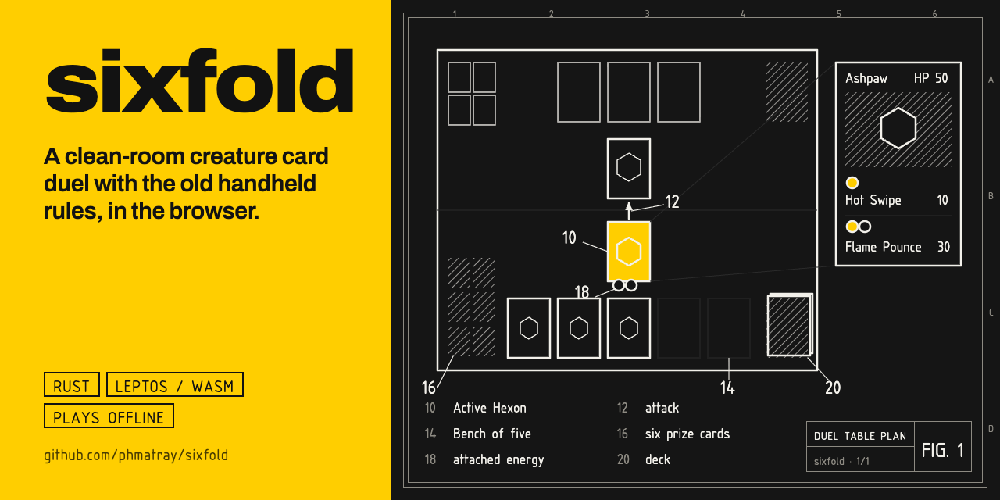
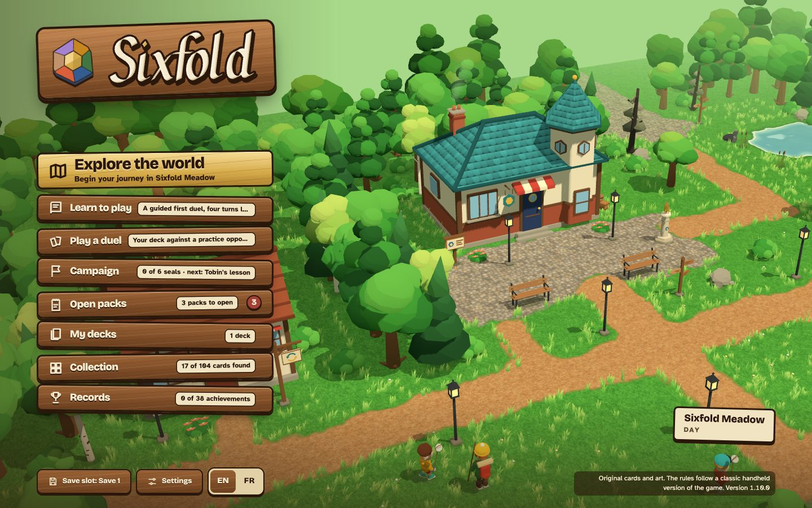
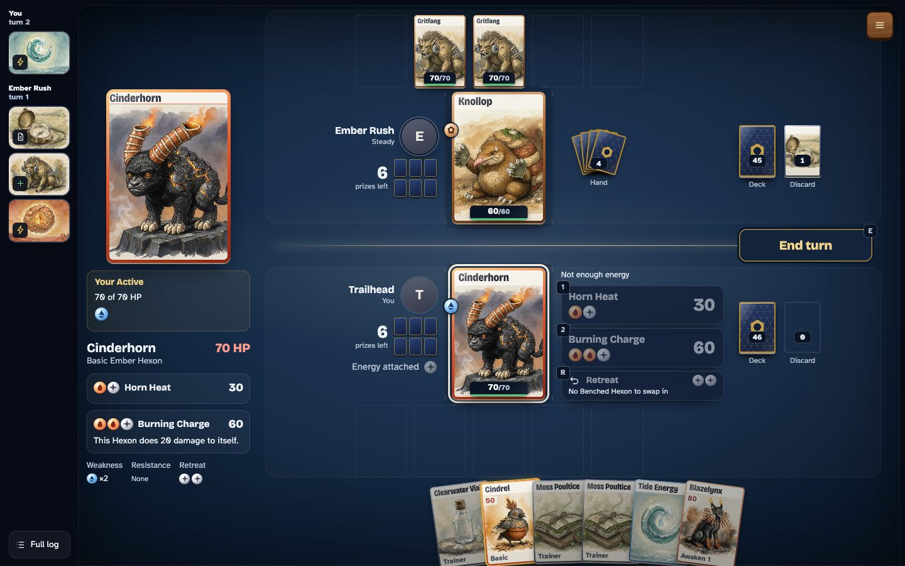
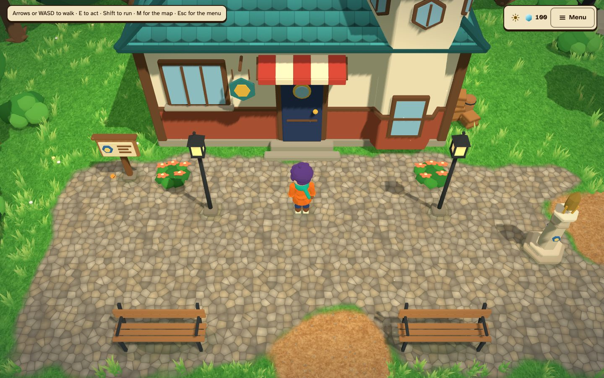
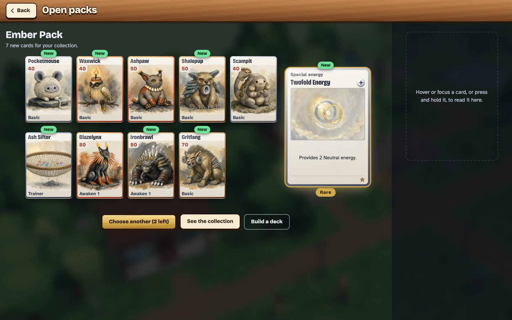
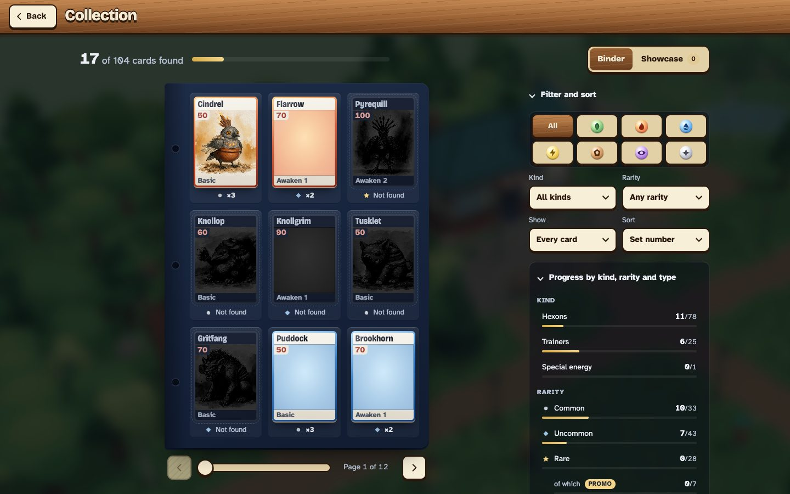
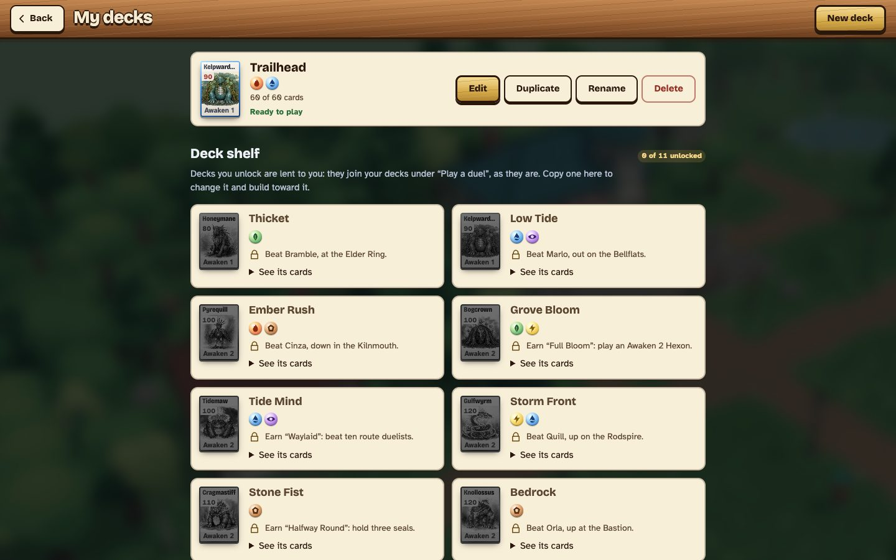
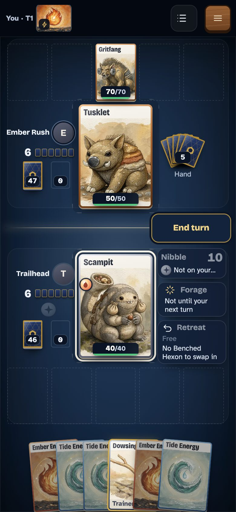

<p align="center"></p>

<p align="center"></p>

<p align="center">
  <a href="https://phmatray.github.io/sixfold/"><b>▶ Play it in the browser</b></a>
  · free, no account, nothing to download first
</p>

<p align="center">
  <a href="https://github.com/phmatray/sixfold/releases/latest"></a>
  <a href="https://github.com/phmatray/sixfold/actions/workflows/ci.yml"></a>
  <a href="https://github.com/phmatray/sixfold/actions/workflows/pages.yml"></a>
  <a href="LICENSE"></a>
</p>

# Sixfold

A clean-room card duel between Hexons, the creatures of Sixfold, played with the
rules of the old handheld game. Walk a small 3D world, collect cards from booster
packs, build your own decks, earn six seals from the region keepers, beat Sable the
Hex Warden, then take on the Gauntlet.

It's written in **Rust**: a pure rules engine, and a **Leptos** web app compiled to
**WebAssembly** with a **three.js** world. It installs as an app, plays offline, and
speaks English and French.

<p align="center"></p>

## Screenshots

| | |
|---|---|
|  |  |
| **The duel.** The whole table on one screen, every card readable in the inspector. | **The world.** Walk the meadow, talk, find, and get challenged on the roads. |
|  |  |
| **Booster packs**, revealed card by card. | **The binder**, with a progress line for every kind and rarity. |
|  |  |
| **Decks** to build, copy and unlock. | **On a phone**, in portrait or landscape. |

## What's in the game

**The duel** (`engine/`). The whole duel, from setup and mulligans through
attacks, conditions, Powers, trainers, knock-outs, prizes and sudden death, in pure
Rust with no browser needed and 450+ unit tests. An AI opponent at three levels:
Easy skips a trainer or Power play one time in four; Hard thinks a turn ahead, trying
its candidate moves on copies of the game where every card it can't see and every
coming coin are dealt anew. Every level sees only what its player may see. The
duel has hit-stop, damage stamps, prize flights and a battle log; the seed fixes the
shuffles and coin flips, so a seed replays the same duel.

**The cards.** 110 original cards: 78 Hexons in Awakening lines across seven
colours (Ember, Tide, Grove, Storm, Stone, Dream and Neutral), 25 trainers, 6 basic
energies and a special energy, each with its own painted illustration and lore.
Seven are promos you earn rather than pull. Booster packs (one per colour, plus
Wild) have slot odds and holo foil. A balance sweep plays every deck against every
other ([`docs/BALANCE.md`](docs/BALANCE.md)), and a test keeps each prebuilt deck
between 30% and 70%.

**Collection and decks.** A binder of every card, a deck builder with an auto mode
and suggestions, and a shelf of decks you unlock by beating rivals and earning
achievements. Facets (⬡), the world's one currency, buy packs, singles at the Swap
Shop and a printed card at Brightwell Press. Mags's Deck Clinic reads a deck and
suggests swaps from your own cards.

**The world** (`web/world/`). Sixfold Meadow is the hub of a ring of six colour
regions, 21 outdoor maps in all, plus houses, inns and the duel hall. Day and night,
field items that open paths in other regions, 13 waymarks for fast travel, finds
marked by fireflies, books on the shelves, benches to sit on, and more than fifty
route duelists who spot you down a line of sight and walk over (**Not now** always
works). Only the area you stand in is built, so it stays smooth on a phone.

**The campaign.** Six seal keepers wait at their region's seal site, each with their
own deck, AI style, theme and entrance; a keeper accepts once you've beaten enough of
their region's duelists. Six seals open the sealed door to Sable, the Hex Warden.
Beating Sable rolls the credits and makes you champion; then the **Gauntlet** (all six
keepers in a row, sharper decks, one loss ends it) and a **daily duel** open up.
Quests live in a Journal, and 38 achievements in Records.

**For everyone.** Keyboard, mouse, touch or gamepad (remappable); every screen works
with the keyboard alone, a screen reader hears one summary of each turn, touch
targets are at least 44 px, and animations calm down with the system's
reduced-motion setting. Three save slots, saved as you play, with export and import.
Every screen, card, rule and line of dialogue is in English and French.

The full history is in the [changelog](CHANGELOG.md) and the plan for each version in
the [roadmap](docs/ROADMAP.md).

## How to play

**Your first duel.** A new save opens on **Learn to play**: a guided duel of four
turns. A note above your hand says what to do next and why, and a ring marks the card
or button to press; only the move the lesson asks for is offered. It ends by handing
you your starter deck and three packs. **How to play** on the title replays it.

**A duel, step by step.**

1. **Setup.** Choose a Basic Hexon as your Active, put more Basics on your Bench, then
   press **Done**.
2. **Your turn.** Click a card in your hand to see what it can do: place it, attach
   energy (once per turn), awaken, or play a trainer.
3. **Act.** The action bar has your attacks (with the damage they would do now),
   Retreat, Powers and End turn. An attack ends your turn.
4. **Win.** Take all your prizes, leave the opponent with no Hexon in play, or outlast
   a deck that runs out of cards.

**Controls in the world.**

| | Keyboard | Gamepad | Touch |
|---|---|---|---|
| Walk | Arrows or WASD | Stick or D-pad | On-screen arrows (tap to walk in Options) |
| Talk, use | E | A | Tap the prompt |
| Run | Shift | X, or the stick pushed all the way | |
| Menu | Esc | Start | Menu button |
| Journal, map | J, M | Y, Select | In the menu |

**Install and play offline.** Open the game once online, then use the browser's
Install button (Chrome, Edge) or Share → Add to Home Screen (Safari). The app starts
with no connection; each area of the world is kept after your first visit.

**Saves.** **Save slot** on the title lists the three slots. **Settings → Export save**
downloads the current slot as a text file; an import is checked first and shown next
to the save it would replace, and a damaged file never touches your progress.

## Rules

The rules follow the original Game Boy game, not the modern card game, with two
deliberate changes: the player who goes first draws but can't attack on their first
turn, and a free-attach Power gives one extra energy a turn, not unlimited ones. There
is no Burned condition, confusion hurts the attacker for 20, weakness doubles damage,
resistance takes off 30, a mulligan gives the opponent no extra cards, the Bench holds
5, and a tie goes to sudden death with one prize each.

[`docs/RULES.md`](docs/RULES.md) lists every rule with an ID (for example
`R-STATUS-07`), its exact values, the evidence for it, and the engine test that covers
it.

## Build from source

Prerequisites: [rustup](https://rustup.rs) with the `wasm32-unknown-unknown` target,
and [Trunk](https://trunkrs.dev).

```bash
rustup target add wasm32-unknown-unknown
cargo install trunk

cd web && trunk serve            # http://localhost:8080 (first build takes ~2 min)
cd web && trunk build --release  # static site in web/dist

cargo test -p sixfold-engine     # rules, card set, campaign and AI tests
cd e2e && npm ci && npx playwright test   # browser journeys against web/dist
```

In a debug build (`trunk serve`), adding `?autoplay` to the URL lets the Hard AI play
your seat too, which is handy for watching whole duels or reaching the credits.

### Desktop build

The same game in a native window ([Tauri](https://tauri.app) v2, in `desktop/`). Run from
the repository root; each command runs Trunk itself.

```bash
cargo install tauri-cli --version "^2" --locked

cargo tauri dev                  # the game in a desktop window, served by trunk serve
cargo tauri build                # on Windows / Linux: installer / AppImage in target/release/bundle
cargo tauri build --bundles app  # on macOS: a Sixfold.app to try locally (not shipped yet)
```

Every GitHub Release carries the Windows installer and the Linux AppImage.

| Path | What's there |
|---|---|
| [`engine/`](engine) | The rules core: duel, cards, AI, campaign, saves. Pure Rust, no WASM or UI dependency. |
| [`web/`](web) | The Leptos app (built by Trunk from `web/index.html`), the three.js world, audio and the service worker. |
| [`desktop/`](desktop) | The desktop app: the web build in a native window (Tauri v2). |
| [`e2e/`](e2e) | Playwright journeys, axe-core checks, and `readme-shots.mjs`, which takes this README's screenshots. |
| [`tools/`](tools) | Map and token checks, the card-art generator. |
| [`docs/`](docs) | Rules, engine API, balance, set and world design, level design, roadmap. |

Releases are cut by release-please from Conventional Commits, and every push to
`main` that passes CI deploys to GitHub Pages.

## Scope and legal

- Only the game's **rules and mechanics** are implemented. Those can't be copyrighted.
- Nothing from Nintendo, Game Freak or The Pokémon Company is included or shipped: no
  card art, names, attack names, flavor text, card stats, sprites or data tables.
  Every card name, number and rules text here is original.
- The card illustrations are original paintings generated locally from a
  hand-written caption per card ([`tools/art/README.md`](tools/art/README.md)); the
  world's models are made for this game, and the music and sounds are synthesised in
  the browser.
- The game's beings are called **Hexons**, a name coined for Sixfold, and evolution is
  called **Awakening**. (The code keeps the neutral identifiers `Creature` and
  `evolve`.)
- A reference ROM may sit in the repository root for local study only. It is
  git-ignored (`*.gbc`) and must never be committed or shipped; CI fails if one is.

[MIT licence](LICENSE) © 2026 Philippe Matray · made by Atypical Play.
